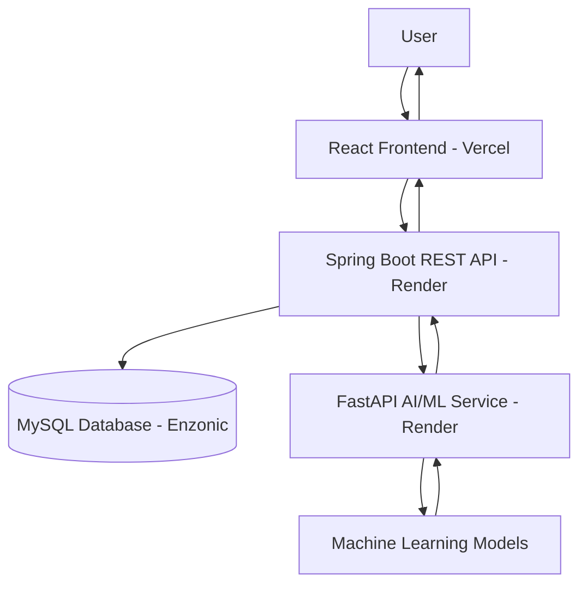

# 🎓 Campus 360 — Intelligent Campus Management System

<p align="center">
  <strong>A Unified Academic Management Platform with AI/ML Integration</strong>
</p>

<p align="center">
  <a href="https://campus-360-peach.vercel.app">🌐 Live Application</a> •
  <a href="https://github.com/varun-004/Campus-360">💻 GitHub Repository</a>
</p>

<p align="center">
  
  
  
  
  
</p>

---

## 📌 Overview

**Campus 360** is an intelligent campus management platform designed to centralize academic activities and provide insights into student performance.

The platform combines full-stack web development with AI/ML capabilities to support academic management, student monitoring, performance analysis, and data-driven decision-making.

It uses a modular architecture with a React frontend, Spring Boot backend, MySQL database, and a Python-based FastAPI machine learning service.

## 🌐 Live Deployment

| Component | Platform | Link |
|---|---|---|
| Frontend | Vercel | [Open Campus 360](https://campus-360-peach.vercel.app) |
| Backend API | Render | [Backend Service](https://campus-360-backend-n3ci.onrender.com) |
| AI/ML Service | Render | Deployed separately |
| Database | Enzonic | MySQL 8.4 |

> Note: Render free services may take some time to respond after periods of inactivity.

## ✨ Key Features

### Academic Management
- Student management
- Course management
- Student enrollment
- Attendance tracking
- Academic marks management

### Analytics and Intelligence
- Dashboard analytics
- Student performance monitoring
- Attendance analysis
- Academic insights
- AI/ML-powered capabilities through the FastAPI service

### Application Architecture
- React-based user interface
- REST API communication
- Spring Boot backend services
- MySQL relational database
- Separate Python FastAPI ML service

## 🛠️ Technology Stack

| Layer | Technologies |
|---|---|
| Frontend | React.js, Vite, JavaScript |
| Styling | CSS / Tailwind CSS (as implemented) |
| Backend | Java, Spring Boot |
| Database | MySQL 8.4 |
| AI/ML Service | Python, FastAPI |
| API Communication | REST APIs, Axios (if configured) |
| Frontend Hosting | Vercel |
| Backend Hosting | Render |
| AI/ML Hosting | Render |
| Database Hosting | Enzonic Databases |
| Version Control | Git, GitHub |

## 🏗️ System Architecture



### Architecture Explanation

1. **Frontend:** React provides the user interface and communicates with the backend through REST APIs.
2. **Backend:** Spring Boot handles application logic, authentication, authorization, and academic management operations.
3. **Database:** MySQL stores application and academic information.
4. **AI/ML Service:** FastAPI provides a separate service for machine learning operations.
5. **Deployment:** The frontend, backend, AI/ML service, and database are hosted independently.

## 📂 Project Structure

```text
Campus-360/
│
├── campus-360-frontend/
│   ├── src/
│   ├── public/
│   ├── package.json
│   └── vite.config.js
│
├── campus-360-backend/
│   ├── src/
│   │   ├── main/
│   │   └── test/
│   ├── Dockerfile
│   ├── docker-compose.yml
│   └── pom.xml
│
├── ai-ml-service/
│   ├── main.py
│   ├── Dockerfile
│   └── requirements.txt
│
└── README.md
```

## ⚙️ Local Installation and Setup

### Prerequisites

Install the following:

- Node.js and npm
- Java 17 or compatible JDK
- Maven
- MySQL 8.0 or compatible
- Python 3.12 or compatible
- Git

### 1. Clone the Repository

```bash
git clone https://github.com/varun-004/Campus-360.git

cd Campus-360
```

### 2. Configure the Database

Create a MySQL database using the database name expected by your backend configuration.

```sql
CREATE DATABASE student_management_db;
```

Configure your database credentials in the backend environment.

### 3. Start the Spring Boot Backend

```bash
cd campus-360-backend
```

Run the application using the Maven wrapper:

**Windows:**
```powershell
.\mvnw.cmd spring-boot:run
```

**Linux / macOS:**
```bash
./mvnw spring-boot:run
```

Backend default URL:

```text
http://localhost:8080
```

### 4. Start the AI/ML Service

Open another terminal:

```bash
cd ai-ml-service
```

Create and activate a virtual environment:

```bash
python -m venv venv
```

**Windows:**
```powershell
venv\Scripts\activate
```

**Linux / macOS:**
```bash
source venv/bin/activate
```

Install dependencies:

```bash
pip install -r requirements.txt
```

Start FastAPI:

```bash
uvicorn main:app --host 0.0.0.0 --port 8000
```

AI/ML service default URL:

```text
http://localhost:8000
```

### 5. Start the Frontend

Open another terminal:

```bash
cd campus-360-frontend
```

Install dependencies:

```bash
npm install
```

Configure the frontend API URL in your environment file:

```env
VITE_API_BASE_URL=http://localhost:8080
```

Start the development server:

```bash
npm run dev
```

Open the local frontend URL shown by Vite in your terminal.

## 🔐 Environment Configuration

Configure environment variables for each service. Never commit passwords, API keys, or production secrets to GitHub.

### Frontend

```env
VITE_API_BASE_URL=http://localhost:8080
```

### Spring Boot Backend

Configure the database and AI/ML service URL:

```env
SPRING_DATASOURCE_URL=jdbc:mysql://localhost:3306/student_management_db
SPRING_DATASOURCE_USERNAME=your_username
SPRING_DATASOURCE_PASSWORD=your_password
AI_ML_SERVICE_URL=http://localhost:8000
```

### AI/ML Service

Add only the environment variables required by your actual ML implementation.

## 🚀 Deployment Architecture

| Service | Hosting Platform |
|---|---|
| React Frontend | Vercel |
| Spring Boot Backend | Render |
| FastAPI AI/ML | Render |
| MySQL Database | Enzonic Databases |

### Production URLs

**Frontend**

https://campus-360-peach.vercel.app

**Backend**

https://campus-360-backend-n3ci.onrender.com

The AI/ML service communicates with the backend using its configured service URL.

## 📸 Application Screenshots

Add screenshots of your actual application in this section.

Suggested screenshots:

- Login and Registration
- Main Dashboard
- Student Management
- Course Management
- Attendance Management
- Marks and Performance
- Analytics and AI/ML features

You can store screenshots in a folder such as:

```text
docs/screenshots/
```

Example Markdown:

```markdown

```

## 🔮 Future Enhancements

- Advanced predictive student performance analytics
- Early identification of students at academic risk
- Intelligent academic recommendations
- Enhanced reporting and visualization
- Additional AI/ML-powered academic insights
- Improved monitoring and scalability

## 👨‍💻 Developer

**Varun G A**

MCA Student | Full Stack Developer

- GitHub: [varun-004](https://github.com/varun-004)
- Project Repository: [Campus 360](https://github.com/varun-004/Campus-360)
- Live Application: [Campus 360](https://campus-360-peach.vercel.app)

---

<p align="center">
  <strong>Campus 360 — Connecting Academic Management with Intelligent Insights.</strong>
</p>
